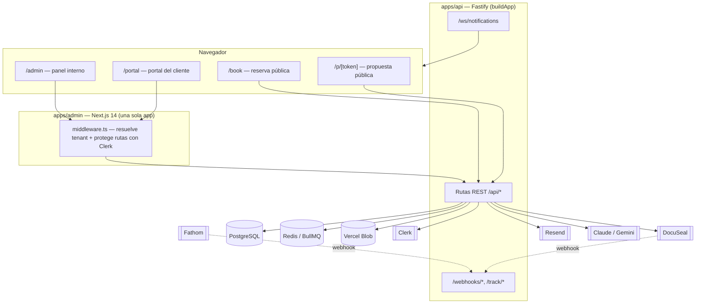

# Arquitectura — SynousAI CRM

Este documento complementa al [`README.md`](../README.md) (setup/run/test) y al
[`CLAUDE.md`](../CLAUDE.md) (convenciones y reglas de negocio). Acá está el
**cómo está armado el sistema**: quién habla con quién, dónde vive cada decisión
de seguridad y multi-tenancy, y qué limitaciones conocidas hay que tener en
cuenta antes de tocar código en producción.

Audiencia: alguien que se suma al equipo y necesita entender el sistema sin
tener que preguntarle a los fundadores.

---

## Tabla de contenidos

- [Visión general](#visión-general)
- [Modelo de autenticación](#modelo-de-autenticación)
- [Modelo multi-tenant](#modelo-multi-tenant)
- [Anatomía de un módulo](#anatomía-de-un-módulo)
- [Convenciones de error y respuesta](#convenciones-de-error-y-respuesta)
- [Flujos de negocio clave](#flujos-de-negocio-clave)
- [Integraciones externas](#integraciones-externas)
- [Procesamiento asíncrono, tiempo real y deploy de la API](#procesamiento-asíncrono-tiempo-real-y-deploy-de-la-api)
- [Almacenamiento de archivos y seguridad de descarga](#almacenamiento-de-archivos-y-seguridad-de-descarga)
- [Deploy y migraciones](#deploy-y-migraciones)
- [Limitaciones conocidas / decisiones abiertas](#limitaciones-conocidas--decisiones-abiertas)

---

## Visión general



**Dos apps, no tres.** `apps/admin` es una única aplicación Next.js que sirve
cuatro superficies distintas bajo el mismo dominio (o subdominios, ver
[multi-tenant](#modelo-multi-tenant)): el panel interno (`/admin`), el portal
de cliente (`/portal`), la reserva pública de calendario (`/book`) y la vista
pública de propuesta (`/p/[token]`). Existió un `apps/client-portal` standalone
que hoy sigue en disco pero **no está en git** (`git ls-files` no lo lista) y
solo contiene caché de build (`.next/`, `.turbo/`, `node_modules/`) — no es un
workspace de pnpm activo ni se despliega; es basura que puede borrarse.

`apps/api` es Fastify puro (`buildApp()` en `apps/api/src/app.ts`), sin ningún
framework de CRM de terceros: pipeline, deals, facturación, propuestas y change
requests están construidos a mano sobre Drizzle + PostgreSQL.

---

## Modelo de autenticación

Toda la autenticación de sesión es **Clerk** — no hay JWT propio para login.
`ACCESS_TOKEN_SECRET` (variable requerida) NO es un secreto de sesión: firma
únicamente tokens de negocio puntuales — cancelar/reprogramar un booking
(`jwt.sign`/`jwt.verify` en `calendar.service.ts`) y la firma HMAC de los
links de click-tracking (`signClickTarget` en `email-tracking.service.ts`).
El onboarding **no** usa este secreto: es post-venta y corre autenticado con
`client_account` (Clerk) dentro del Client Portal, no con un token propio.

Hay **dos identidades completamente separadas**, resueltas por tabla distinta:

| | `hub_user` (equipo/admin) | `client_account` (cliente del portal) |
|---|---|---|
| Middleware HTTP | `authenticate` (`apps/api/src/middleware/authenticate.ts`) | `authenticateClient` (`authenticate-client.ts`) |
| Resolución | `verifyClerkToken` → `resolveHubUser` (`clerk-auth.ts`) | `verifyClerkToken` → `resolveClientAccount` |
| Distinción | `publicMetadata.userType` de Clerk + lookup en `hub_user` por `clerk_user_id` | ídem, lookup en `client_account` |
| Roles | `owner` / `member` / `collaborator` / `viewer` | ninguno — todo cliente ve solo su propio deal |
| Contexto en request | `request.hubUser = { sub, portalId, role }` | `request.clientAccount = { sub, portalId, contactId, type: 'client_access' }` |

`resolveHubUser`/`resolveClientAccount` viven en
`apps/api/src/middleware/clerk-auth.ts` y son compartidas entre HTTP y los
handlers de WebSocket (para no duplicar el lookup). Actualmente van directo a
DB en cada request — hay una caché Redis **documentada como pendiente** en el
propio archivo (`TODO: implementar cuando se instale ioredis`), tolerable hoy
por el volumen bajo de un equipo de dos personas.

**Autorización por rol:** `authorize('owner', 'member', 'collaborator')` como
`preHandler` después de `authenticate`, en rutas donde la acción tiene costo
(crear/enviar un documento para firma, borrar un documento, editar branding o
una propuesta). Ejemplo real: `documents.router.ts` exige `owner` para borrar
un documento pero `owner|member|collaborator` para crear/enviar a firma —
`viewer` nunca pasa ninguna de las dos.

Un `client_account` **nunca** puede resolver como `hub_user` y viceversa: son
tablas, middlewares y tokens de negocio distintos. El middleware de Next
(`apps/admin/middleware.ts`) hace un primer filtro conveniente por ruta, pero
lo aclara él mismo en un comentario: la única verdad de autorización vive en el
backend. Un admin logueado que llegue a `/portal/*` sin haber sido redirigido
igual recibe 401 del backend.

---

## Modelo multi-tenant

Cada fila núcleo (deal, contact, company, invoice, document, …) tiene
`portal_id`. La regla de oro:

> **`portalId` sale SIEMPRE de la sesión verificada (`request.hubUser.portalId`
> / `request.clientAccount.portalId`), nunca del input del request.**

El tenant se resuelve por **subdominio** (`<slug>.synousai.com`) o por
`/c/<slug>` (white-label sin subdominio propio), en
`apps/admin/middleware.ts`, que reescribe a `/portal/*` seteando la cookie de
tenant. El host `admin.*` sirve el panel interno sin prefijo de URL.

### La guardia de FKs que llegan en el body

Postgres garantiza que una foreign key **exista**, no que sea del **mismo
tenant**. Antes de esta auditoría, un usuario del portal A podía mandar en el
body de un `PATCH /deals/:id` el `companyId` de una empresa del portal B, y
quedaba colgada de su deal — legible después desde el detalle. La fila
formaba un vínculo válido a nivel de constraint mientras cruzaba tenants a
nivel de negocio.

`apps/api/src/lib/portal-access.ts` centraliza el fix con cuatro guardias:

- `assertDealInPortal(portalId, dealId, executor?)` — ya existía; ahora acepta
  un `tx` opcional para poder llamarse dentro de una transacción.
- `assertCompanyInPortal(portalId, companyId, executor?)`
- `assertContactInPortal(portalId, contactId, executor?)`
- `assertHubUsersInPortal(portalId, userIds[], executor?)`

**Regla:** todo id de relación que llega en un body (`companyId`,
`primaryContactId`, `ownerId`, …) se valida contra el portal del caller antes
de escribir. `null`/`undefined` pasan (desvincular es legítimo). Aplicado hoy
en `deals`, `finance` (invoices/expenses), `documents` y `calendar` (event
types). Al agregar un endpoint nuevo que acepte un FK-id en el body, este es el
primer lugar a mirar — no asumir que el constraint de Postgres alcanza.

`Executor` (`DB | Tx`) importa por lo mismo que documenta el propio archivo:
dentro de una transacción hay que pasarle el `tx`, porque consultar con el
`db` global pide una segunda conexión del pool mientras la transacción retiene
la suya — con pools chicos (Neon serverless: máx. 5 por instancia) eso es un
deadlock esperando a pasar.

---

## Anatomía de un módulo

```
src/modules/<nombre>/
  <nombre>.router.ts   → rutas Fastify + validación Zod (entrada y salida)
  <nombre>.service.ts  → lógica de negocio y acceso a DB
  <nombre>.schema.ts   → schemas Zod de request/response
  <nombre>.types.ts    → tipos TypeScript del módulo
```

Algunos módulos con audiencia dual duplican el prefijo: `cr.router.ts` (admin)
+ `client-cr.router.ts` (cliente) comparten `cr.service.ts`; lo mismo
`notifications.router.ts` (expone `notificationsRoutes` +
`clientNotificationsRoutes`) y `files.router.ts` (`filesRoutes` +
`clientFilesRoutes`). Es deliberado: la lógica de negocio es una sola, pero la
superficie HTTP y el middleware de auth son distintos por audiencia.

`apps/api/src/modules/` tiene 34 módulos de dominio (contar
`ls apps/api/src/modules` es más confiable que cualquier lista fija en un doc,
así que no se repite acá el listado completo — ver la tabla del
[`README.md`](../README.md#módulos-de-la-api)).

---

## Convenciones de error y respuesta

- Respuestas: `{ data, meta? }` en éxito, `{ error: { code, message, details? } }`
  en error. Central en el `setErrorHandler` de `app.ts`.
- Errores de negocio: `AppError(code, message, statusCode)` (helpers en
  `lib/errors.ts`, ej. `Errors.badRequest`, `Errors.notFound`,
  `Errors.unauthorized`).
- Validación: Zod en request y response de cada endpoint
  (`fastify-type-provider-zod`); un `ZodError` no capturado se traduce a 400
  `VALIDATION_ERROR` por el error handler central.
- Paginación por **cursor** (`limit` + `cursor`), nunca `offset`, en listados
  grandes. `apps/admin/lib/fetch-all-pages.ts` sigue ese cursor hasta agotarlo
  para las pantallas que necesitan la lista completa (ver
  [limitaciones del frontend](#limitaciones-conocidas--decisiones-abiertas)).
- Soft delete: `archived = true` + `archived_at = now()`, nunca `DELETE`, en
  entidades núcleo. Cobertura real hoy: `deal`, `contact`, `company`, y desde
  la migración `0038` también `document` y `deliverable`, y desde la `0041`
  `note` y `task` (antes se borraban en duro).
- Cambios de campo en entidades núcleo → `record_history` (referencia
  polimórfica `entity_type` + `entity_id`, `old_value`/`new_value`),
  implementado en el service, nunca en el router.

---

## Flujos de negocio clave

### 1. Cambio de etapa → activación del Client Portal (en dos fases)

`dealService.changeStage()` (`apps/api/src/modules/deals/stage.service.ts`) es
la única vía permitida para tocar `stage_id` — nunca un `UPDATE` directo desde
el router. Dentro de una transacción: actualiza el deal, escribe
`record_history` + `audit_log`, resuelve reasignación de owner si el pipeline
es "Producción", y si el stage nuevo tiene `is_won = true` llama a
`activateClientPortal(tx, portalId, dealId)`.

**Por qué está partida en dos funciones:** `activateClientPortal` hace
*solamente* trabajo de DB (crea `client_account` + `client_deal_access`, marca
el contacto `customer`) y es idempotente — puede llamarse de nuevo sin
duplicar nada. Antes, las llamadas HTTP a Clerk (crear usuario, invitar)
corrían **dentro** de esa misma transacción: un round-trip lento a Clerk
retenía el lock de la fila del deal, y si la transacción hacía rollback el
usuario de Clerk ya había quedado creado igual (no hay rollback de un
side-effect externo).

El fix: `activateClientPortal` devuelve un descriptor `PortalActivation | null`
(o `null` si no hay nada que hacer: sin contacto/email, o cuenta ya vinculada a
Clerk). El caller (`changeStage`, el webhook de DocuSeal, o
`activateClientPortalManually`) **espera el commit** y recién ahí llama a
`completeClientPortalActivation(activation)`, que es best-effort: crea la
invitación de Clerk, vincula `clerkUserId`, y manda el email
(`sendPortalInvitationEmail`, que solo sella `inviteSentAt` si el envío salió
de verdad). Si Clerk o Resend fallan acá, la cuenta y el acceso al deal **ya
existen** — se loguea y una activación posterior (botón manual del admin)
reintenta porque `needsClerkUser` sigue en `true`.

Se dispara desde tres lugares:
- `changeStage` cuando el stage nuevo es `is_won`.
- El webhook de DocuSeal cuando un documento tipo `contract` llega a
  `form.completed` (ver flujo 2).
- `activateClientPortalManually` — botón manual desde el detalle de deal en el
  admin.

### 2. Firma de DocuSeal → webhook → activación

`apps/api/src/modules/documents/docuseal.client.ts` es un cliente HTTP real
(no solo modelado): auth por header `X-Auth-Token`, timeout de 15s
(`DOCUSEAL_TIMEOUT_MS`), y `isDocusealConfigured()` hace que los endpoints
respondan `503` en vez de fallar feo si falta `DOCUSEAL_API_KEY`.

**Regla de oro (también en CLAUDE.md):** las URLs de documentos firmados
expiran a los 40 minutos. Se guarda `docuseal_submission_id`, nunca la URL —
se pide de nuevo con `fetchSubmissionDocuments` en el momento en que hace
falta.

El webhook (`POST /webhooks/docuseal`, `webhooks.router.ts`) valida un token
fijo en el header `X-Docuseal-Signature` (o `X-Webhook-Secret`) contra
`DOCUSEAL_WEBHOOK_SECRET` **antes** de tocar el body — si no valida, `401` sin
detalle (no revela que el endpoint existe). El payload se valida con Zod
**después** de la firma; si no matchea el schema, responde `200` igual (un
`4xx` haría que DocuSeal reintente para siempre algo que un reintento no va a
arreglar).

Idempotencia real: el `UPDATE` de `document.docusealStatus` lleva la condición
`WHERE (docuseal_status IS NULL OR docuseal_status <> newStatus)` **dentro** de
la transacción. Un chequeo previo fuera de la transacción no alcanza —dos
entregas concurrentes del mismo evento lo pasarían las dos—; acá la segunda
entrega espera el lock de fila, no matchea la condición, y no vuelve a
activar el portal ni a duplicar el `record_history`.

### 3. Máquina de estados de Change Requests

`ADMIN_TRANSITIONS` en `cr.service.ts` es la única fuente de verdad de
transiciones válidas (el admin del frontend la espeja, no la reemplaza):
`draft → sent`, `sent → approved|approved_verbally|negotiating|disputed|rejected`,
`negotiating → approved|approved_verbally|disputed|rejected|sent`, etc.
`transitionCR` valida contra esa tabla y lanza `badRequest` si la transición no
está permitida.

El cliente solo puede decidir (`clientDecision`, aprobar/rechazar) cuando el
status está en `CLIENT_DECIDABLE_STATUSES = ['sent', 'negotiating']`. Una CR en
`draft` es **404** para el cliente (`clientListCRs` filtra
`status <> 'draft'`), no solo "no editable" — así un borrador nunca es
enumerable desde el portal.

Transiciones y decisiones corren en transacción con concurrencia optimista: el
`UPDATE` de status incluye `WHERE status = <status leído>`, así que si dos
actores (ej. admin transiciona mientras el cliente decide) chocan, uno de los
dos falla en vez de pisar silenciosamente al otro.

### 4. Numeración de facturas

El número de factura es correlativo **por portal**, no global. La carrera
entre dos facturas emitidas al mismo tiempo se cierra con
`pg_advisory_xact_lock(hashtext('invoice-number:' || portalId))` — se libera
solo al commit/rollback de la transacción, así que serializa la numeración por
portal sin bloquear la tabla entera. La migración `0038` agrega
`UNIQUE(portal_id, number)` en `invoice` como red de seguridad detrás del lock
(defensa en profundidad, no el mecanismo principal).

**Antes de deployar la migración `0038` a producción**, verificar que no haya
números duplicados hoy — si los hay, el `ALTER TABLE ... ADD CONSTRAINT`
falla:

```sql
SELECT portal_id, number, count(*)
FROM invoice
GROUP BY 1, 2
HAVING count(*) > 1;
```

---

## Integraciones externas

| Servicio | Auth | Timeout | Idempotencia | Si falla / no está configurado |
|---|---|---|---|---|
| **Clerk** | `CLERK_SECRET_KEY`, verificación JWT (JWKS) | — | — | Sin la key, `verifyToken` falla en cada request → nadie autentica (falla ruidosa, no silenciosa) |
| **DocuSeal** | Header `X-Auth-Token` (`DOCUSEAL_API_KEY`) | 15s | Webhook: `UPDATE` condicionado dentro de tx (ver flujo 2) | `isDocusealConfigured() === false` → endpoints responden `503 DOCUSEAL_UNAVAILABLE`; webhook sin `DOCUSEAL_WEBHOOK_SECRET` responde 401 a todo |
| **Resend** | `RESEND_API_KEY` | — | No aplica (no hay reintento automático) | Sin key: `sendEmail` loguea y retorna sin error (modo dev/test). Con key, si Resend devuelve `{ error }`, `sendEmail` **lanza** `EMAIL_SEND_FAILED` — antes se tragaba el error y el caller sellaba `inviteSentAt`/similares como si hubiese salido |
| **Fathom** | HMAC-SHA256 en header `X-Fathom-Signature` | — | Ninguna explícita (payload duplicado reprocesa) | Firma inválida → 401 sin detalle; payload que no matchea el Zod schema → 200 (no reintentar algo que no se va a arreglar) |
| **Anthropic (Claude) / Gemini (Vertex)** | API key propia por proveedor | 30s (`AI_REQUEST_TIMEOUT_MS`, `lib/ai/types.ts`) | No aplica | Timeout o error → fallback logueado (propuestas / sugerencia de próxima acción degradan, no rompen el request) |
| **Vercel Blob** | Token OIDC (`VERCEL_OIDC_TOKEN`+`BLOB_STORE_ID`) o `BLOB_READ_WRITE_TOKEN` estático | — | — | Sin credenciales → fallback a disco local (ver [almacenamiento](#almacenamiento-de-archivos-y-seguridad-de-descarga)) |

---

## Procesamiento asíncrono, tiempo real y deploy de la API

La API corre en Vercel (proyecto `synous-ai-api`, Fluid compute) como UNA
Function con el preset zero-config de Fastify. De eso dependen tres piezas: el
entrypoint, las notificaciones en tiempo real y los recordatorios.

### Entrypoint y build

`apps/api/src/server.ts` es el único entrypoint (`buildApp()` + `listen()`;
Vercel intercepta el `listen()`). Lo que se deploya es su bundle
`dist/server.js`, que Vercel genera en cada deploy según `apps/api/vercel.json`:

| Clave | Valor | Para qué |
|---|---|---|
| `framework` | `fastify` | Fija el preset aunque cambie la detección automática |
| `buildCommand` | `pnpm run build:bundle` | `tsup src/server.ts` → `dist/server.js` (config en `tsup.config.ts`) |
| `outputDirectory` | `dist` | El preset busca el entrypoint (`server.js`) PRIMERO ahí, después de correr el build |
| `crons` | `/api/cron/reminders`, `*/15 * * * *` | Recordatorios (ver abajo) |

Con `VERCEL` definido, `server.ts` no arranca el worker de BullMQ ni instala
handlers de SIGINT/SIGTERM que llamen a `process.exit`: el ciclo de vida de la
instancia es de la plataforma.

**Por qué un bundle y no `src/server.ts` directo.** Verificado leyendo el código
de los builders publicados en npm (sin deployar): el preset `fastify` usa
`@vercel/fastify@8.0.0`, que delega en `@vercel/node@13.0.0`. Ese builder traza
dependencias con `nft` y transpila CADA `.ts` por separado (renombrándolo a
`.js`), sin bundlear. Con este repo eso rompe de dos formas:

- Los imports relativos sin extensión (`import { buildApp } from './app'`)
  quedan tal cual en un paquete `"type": "module"` → `ERR_MODULE_NOT_FOUND` en
  runtime. Su `rewriteRelativeImportExtensions` solo reescribe imports que YA
  terminan en `.ts`.
- `@synous/shared` exporta `./src/index.ts`: el archivo se transpila y se
  renombra, pero el `exports` de su `package.json` sigue apuntando al `.ts`.

Son las dos caídas de producción que ya tuvo el bundle anterior. El builder que
sí bundlea (`@vercel/backends`, con rolldown) solo se elige para "services" o
con un flag experimental, así que no se puede contar con él. El bundle de tsup
(ESM, `@synous/shared` inlineado, el resto de `node_modules` externo y trazado
por Vercel) tiene la misma forma que el artefacto que ya corría en producción;
la diferencia es que ahora lo genera Vercel en vez de estar commiteado. El CI
buildea el mismo bundle y falla si `@synous/shared` quedó como import externo.

### Notificaciones en tiempo real

- **Bus** (`lib/notification-bus.ts`): con `REDIS_URL`, `emitNotification()`
  publica en el canal `notifications:{portalId}` y cada instancia que sostiene
  sockets de ese portal está suscripta y los reparte. Una conexión publisher y
  una subscriber por instancia, creadas perezosamente; el canal se suscribe con
  el primer socket del portal y se libera con el último. Sin `REDIS_URL` (local,
  tests) reparte en el proceso. Un `PUBLISH` fallido o colgado (timeout 2 s) se
  loguea y no rompe la request: la fila ya está en la DB y el REST es la fuente
  de verdad. `notify.ts` espera el publish porque en Vercel la instancia se
  congela al responder.
- **`GET /ws/notifications`** (solo hub users): el primer mensaje tiene que ser
  `{ "type": "auth", "token": "<Clerk session token>" }` dentro de 5 s; si
  falta, es inválido o vence el plazo, cierra con `1008`. El token por query
  string ya no se acepta (con el entrypoint anterior el upgrade nunca llegaba a
  Fastify, así que no rompe ningún cliente desplegado). Ping cada 25 s: el
  socket que no contestó el anterior se descarta. La suscripción se libera en
  `close` y en `error`. Se entrega solo al portal del usuario y a su `userId`
  (`userId = null` = todo el portal).
- **Cliente:** en Vercel un socket queda fijado a una instancia y se corta al
  llegar a la duración máxima de la Function (300 s). La campana del admin
  (`notification-bell.tsx`) reconecta con backoff exponencial 1 s → 30 s, pide
  un token de Clerk nuevo en cada intento, e invalida `['notifications']` en
  cada push y una vez después de cada reconexión (lo emitido mientras estuvo
  desconectada no se reenvía). El portal del cliente sigue con polling.

### Recordatorios

`runReminderScan()` (tareas vencidas/hoy, deals estancados, recordatorios de
reunión) es idempotente (`dedupeKey` + claim-before-send). Dos disparadores:

- **Vercel:** Vercel Cron llama `GET /api/cron/reminders` cada 15 min (UTC) con
  `Authorization: Bearer <CRON_SECRET>`. Header ausente o inválido → `401` sin
  body; `CRON_SECRET` sin configurar → `503 CRON_NOT_CONFIGURED`.
- **Long-running (local o host propio):** `server.ts` arranca el worker de
  BullMQ (`jobs/reminders.queue.ts`) si hay `REDIS_URL`.

### Pendiente de verificar en el primer deploy

Nada de esto se puede probar sin un deploy real, y no se deployó. Preview
comparte la base de PRODUCCIÓN y no tiene `ACCESS_TOKEN_SECRET`: no es un
sandbox.

1. **Build:** el log muestra `pnpm run build:bundle` y usa `dist/server.js` como
   entrypoint. Si tomara `src/server.ts`, `/health` responde
   `FUNCTION_INVOCATION_FAILED` → rollback.
2. **Arranque:** `GET /health` → 200.
3. **WebSockets (beta):** abrir `wss://<api>/ws/notifications` sin mandar nada →
   cierre `1008` a los ~5 s; con token válido → `{"type":"connected"}`. Confirma
   que el upgrade llega a `@fastify/websocket` detrás del runtime.
4. **Fan-out:** con el Redis del Marketplace conectado (`REDIS_URL`), crear una
   notificación desde otra sesión y ver la campana actualizarse sin esperar el
   polling de 60 s.
5. **Cron:** `CRON_SECRET` cargado en Production; `/api/cron/reminders` aparece
   en Settings → Cron Jobs y la ejecución responde 200. En plan Hobby los crons
   son como mucho diarios y `*/15` no se acepta.
6. **Duración:** la reconexión del admin a los ~300 s no genera errores visibles.

### Rollback

Es un cambio de mecanismo de deploy, sin migraciones ni cambios de datos.

- **Inmediato:** Instant Rollback en Vercel al último deployment anterior a este
  cambio. Vuelve el bundle viejo (y con él, WebSockets y cron sin funcionar, como
  antes).
- **En código**, tomando como base `30dd841` (último commit antes de este cambio):
  1. `git checkout 30dd841 -- apps/api/vercel.json apps/api/serverless/index.ts`
     (vuelven `builds` + rewrite catch-all y el handler serverless).
  2. Volver a agregar `"serverless"` al `include` de `apps/api/tsconfig.json` y
     el script `"build:vercel-api": "tsup serverless/index.ts --outDir api"` en
     `apps/api/package.json`.
  3. Regenerar `apps/api/api/index.js` con `pnpm --filter api build:vercel-api`
     y commitearlo. NO restaurar el de `30dd841`: está desactualizado respecto
     del código actual.
  4. Restaurar en `.github/workflows/ci.yml` el step que verifica que
     `apps/api/api/index.js` esté al día.

  `server.ts`, el bus, el WebSocket y la ruta de cron son compatibles con el
  entrypoint viejo (`serverless/index.ts` solo usa `buildApp()`): no hace falta
  revertirlos.

---

## Almacenamiento de archivos y seguridad de descarga

Detalle completo en [`STORAGE.md`](./STORAGE.md). Lo esencial:

- **Un store privado de Vercel Blob** (`synous-ai-files`) conectado al proyecto
  de la API en Production y Preview. En desarrollo local, disco
  (`apps/api/uploads/`) con el mismo contrato. Producción sin credenciales
  responde `503` en vez de escribir al disco efímero de la Function.
- **Los bytes nunca pasan por la API** (las Functions limitan request y
  respuesta a 4.5 MB): la API autoriza y el browser transfiere directo contra
  Blob con tokens y URLs presignadas de corta vida.
- **La key la genera la API** (`portals/{portalId}/{purpose}/{yyyy}/{mm}/{uuid}.{ext}`)
  y un endpoint de dominio solo la acepta si hay un upload pendiente del mismo
  actor, portal y purpose, con el objeto verificado (`claimUpload`). La tabla
  `file_upload` es el registro de ownership y ciclo de vida.
- **Descargas:** `POST /api/files/access` autoriza por recurso y devuelve una URL
  presignada de 5 minutos. Logos: rutas públicas que solo resuelven keys
  referenciadas como logo.

---

## Deploy y migraciones

- Migraciones Drizzle **forward-only**: no hay `down migration`. Un rollback
  es restaurar desde backup/PITR, no revertir la migración.
- `pnpm --filter api db:generate` genera la migración desde el schema;
  `db:migrate` la aplica. **Nunca** editar archivos en `migrations/` a mano, y
  **nunca** `db:push` en producción (solo dev, salta la historia de
  migraciones).
- Antes de deployar `0038` a producción: correr el chequeo de duplicados de
  número de factura (ver [flujo 4](#4-numeración-de-facturas)) — la
  `UNIQUE(portal_id, number)` falla si hay datos sucios previos.
- El pool de conexiones se bifurca por entorno en `apps/api/src/db/index.ts`:
  Neon serverless (`neon-serverless` driver, `max: 5` por instancia, **sin**
  `statement_timeout` — el pooler de Neon puede rechazar parámetros de arranque
  desconocidos) para producción/preview en Vercel, y `node-postgres`
  (`max: 10`, `statement_timeout: 30_000`) para el proceso long-running local
  o self-hosted. Ambos con `idleTimeoutMillis`/`connectionTimeoutMillis` de
  10s — sin eso, un Postgres saturado cuelga el request en vez de fallar
  rápido.

### Variables de entorno requeridas en producción (fallan en silencio si faltan)

Ninguna de estas rompe el arranque (`env.ts` solo hace fail-fast con
`DATABASE_URL` y `ACCESS_TOKEN_SECRET`), pero su ausencia apaga una feature
completa sin ningún error visible:

| Variable | Sin ella |
|---|---|
| `CLERK_SECRET_KEY` | Nadie puede loguearse (`verifyToken` falla siempre) |
| `RESEND_API_KEY` | No sale ningún email (se loguea y se omite) |
| `ADMIN_URL` | Los links de los emails apuntan a `localhost:3000` |
| `PUBLIC_API_URL` | Los links de tracking/pixel apuntan a `localhost:3001` |
| `DOCUSEAL_API_KEY` + `DOCUSEAL_WEBHOOK_SECRET` | El flujo de firma y la activación del portal por contrato quedan rotos (endpoints 503, webhook 401 a todo) |
| `REDIS_URL` | Sin fan-out entre instancias: un WebSocket solo recibe lo emitido en su propia instancia de la Function |
| `CRON_SECRET` | `GET /api/cron/reminders` responde 503: no corre ningún recordatorio |

Variables usadas en código pero no documentadas hasta ahora en el `.env.example`:

- **API**: `MODEL_PROVIDER`, `ALLOWED_ORIGINS`, `TENANT_ROOT_DOMAIN`,
  `DOCUSEAL_URL`, `DOCUSEAL_API_URL`, `PRODUCTION_ASSIGNEE_DIAGNOSTICO_EMAIL`,
  `PRODUCTION_ASSIGNEE_DEFAULT_EMAIL`.
- **Admin**: `NEXT_PUBLIC_ADMIN_URL`, `NEXT_PUBLIC_APP_URL`,
  `NEXT_PUBLIC_ROOT_DOMAIN`.

---

## Limitaciones conocidas / decisiones abiertas

- **Los WebSockets de Vercel están en beta** y cada conexión dura como mucho
  la duración máxima de la Function; el admin reconecta solo. El portal del
  cliente no tiene canal en vivo (polling). El deploy con este mecanismo está
  pendiente de verificar — ver
  [checklist](#procesamiento-asíncrono-tiempo-real-y-deploy-de-la-api).
- **La caché Redis de `resolveHubUser`/`resolveClientAccount` está pendiente**
  (`clerk-auth.ts` tiene el TODO explícito) — hoy cada request autenticado
  pega contra Postgres.
- **Rate limiting es en memoria y por instancia** (`@fastify/rate-limit`,
  `global: false`, opt-in por ruta vía `config.rateLimit`). Bajo serverless
  con múltiples instancias frías, es una defensa contra abuso de una sola
  fuente, no un límite global exacto.
- **El CI valida pero no despliega**: `.github/workflows/ci.yml` corre
  typecheck, tests contra Postgres, el build del bundle de la API y lint +
  build del admin. Las migraciones de producción siguen corriéndose a mano.
