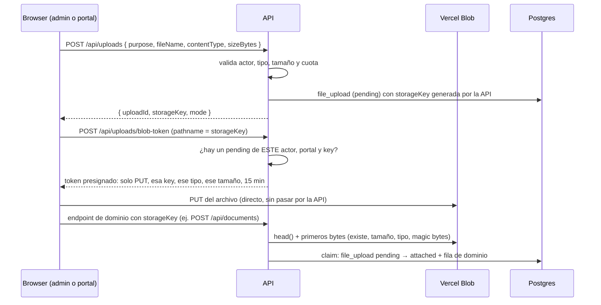
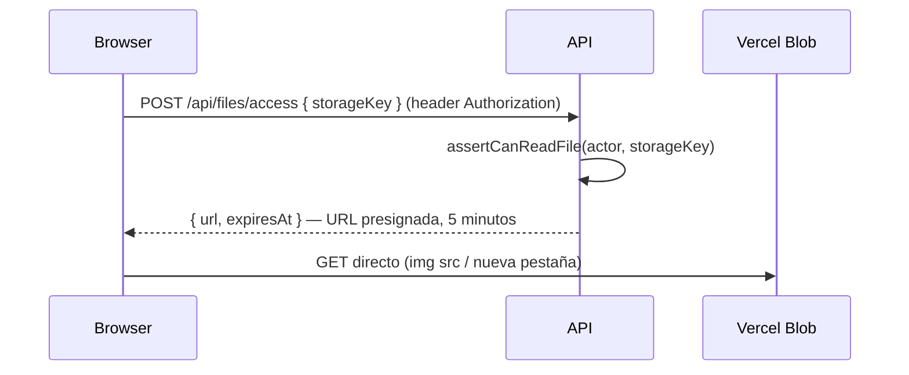

# Almacenamiento de archivos — Vercel Blob

Cómo guarda, sirve y protege archivos el CRM. Para el resto de la arquitectura,
ver [`ARCHITECTURE.md`](./ARCHITECTURE.md).

## Qué es y para qué se usa

[Vercel Blob](https://vercel.com/docs/vercel-blob) es el object storage de
Vercel. El CRM usa **un único store privado** (`synous-ai-files`) para los
archivos que suben las personas. Privado significa que ninguna URL del store es
accesible sin credenciales: toda lectura pasa por una autorización nuestra.

No todo archivo va a Blob. Estos quedan donde están, a propósito:

| Recurso | Dónde vive | Por qué no va a Blob |
|---|---|---|
| Contratos firmados | DocuSeal | Se piden frescos a DocuSeal (la URL caduca a los 40 min); solo se guarda `docuseal_submission_id` |
| PDF de factura | Generado al vuelo (`pdfkit`) | Siempre derivable de los datos |
| PDF de propuesta | Generado al vuelo (`pdfkit`) | Idem |
| Entregables | URL externa (Figma, staging) | No son archivos propios |
| CSV de leads | Generado en el browser | No persiste |

## Recursos que usan Blob

Cada subida declara un **purpose**. La política de cada uno vive en un único
lugar: `apps/api/src/lib/storage/policy.ts`. El frontend solo refleja los MIME en
el atributo `accept`; la API es la única autoridad.

| Purpose | Quién sube | Superficie | Tipos | Máximo | Referencia en DB |
|---|---|---|---|---|---|
| `deal_document` | equipo | Admin → detalle de deal | PDF, PNG, JPEG, WebP, GIF, DOCX, XLSX, PPTX, ZIP | 50 MB | `document.storage_key` |
| `library_item` | equipo | Admin → biblioteca | igual que `deal_document` | 50 MB | `library_item.storage_key` |
| `expense_receipt` | equipo | API de gastos (sin UI todavía) | PDF, PNG, JPEG, WebP | 10 MB | `expense.storage_key` |
| `proposal_logo` | equipo | Admin → editor de propuesta | PNG, JPEG, WebP, GIF | 2 MB | `proposal.content.logoKey` |
| `brand_logo` | equipo o cliente | Admin → White-Label · Portal → brand kit | PNG, JPEG, WebP | 2 MB | `company.brand_logo_key` / `client_account.brand_logo_key` |
| `onboarding_material` | cliente | Portal → onboarding paso 7 | los de documentos + MP4, MOV, WebM/MP3/M4A/OGG/WAV | 100 MB | `client_asset` |

**SVG está excluido en todos los purposes**: puede ejecutar scripts y los logos
se sirven públicamente.

## Arquitectura

### Por qué los archivos no pasan por la API

Las Functions de Vercel limitan **tanto el request como la respuesta a 4.5 MB**.
Un documento, un video de onboarding o un manual de marca superan ese límite. Por
eso la API **autoriza** y el browser **transfiere directo** contra Blob, en ambos
sentidos.

### Subida (tres pasos)



- El cliente usa `/api/client/uploads` y `/api/client/uploads/blob-token`.
- **La key la genera la API**, nunca el browser:
  `portals/{portalId}/{purpose}/{yyyy}/{mm}/{uuid}.{ext}`. No incluye el nombre
  que eligió el usuario (se guarda aparte, saneado), la extensión sale del MIME,
  y el prefijo permite ver dueño y tipo al depurar o migrar.
- **El paso 3 ("claim") es el control de ownership.** Un endpoint de dominio
  solo acepta una key si existe un upload pendiente **del mismo actor, en el
  mismo portal y para el mismo purpose**, y si el objeto existe con el tamaño y
  tipo declarados. Así nadie puede adjuntar a su registro un archivo que no
  subió, ni referenciar la key de otro tenant.
- La persistencia **no depende de `onUploadCompleted`**: ese callback de Vercel
  no llega a localhost y se reintenta, así que no es una fuente confiable de
  estado. No se usa.

### Descarga y preview



- Es **un único endpoint para equipo y cliente**: la API resuelve la sesión y
  aplica la regla del recurso. No existe variante bajo `/api/client`.
- La URL presignada está atada a esa key, es de solo lectura y dura 5 minutos.
  El frontend la renueva antes de que venza (`useFileUrl`).
- Ninguna URL lleva el token de sesión de Clerk (antes se usaba `?token=`, que
  quedaba en historial, logs y `Referer`).

### Logos públicos

Los logos se ven antes del login y en la propuesta pública, así que no pueden
depender de una sesión:

- `GET /api/public/files/brand-logo/<key>` y `GET /api/public/proposals/:token/logo`
  responden `302` a una URL de lectura corta.
- **Solo resuelven keys referenciadas como logo** de un registro activo. Una key
  de documento o de material de onboarding devuelve 404 aunque exista.

## Modelo de seguridad

| Control | Dónde |
|---|---|
| Store privado: ninguna URL directa es legible sin credenciales | configuración del store |
| La key la genera la API y se valida con regex estricta antes de usarse | `lib/storage/keys.ts` |
| Tipos y tamaños por purpose; SVG excluido | `lib/storage/policy.ts` |
| Magic bytes (PNG/JPEG/WebP/GIF, PDF, familia ZIP) al adjuntar | `lib/storage/magic.ts` |
| Token de subida: solo PUT, una key, un tipo, el tamaño declarado, 15 min, sin overwrite | `modules/uploads` |
| Claim: mismo actor + portal + purpose; objeto verificado; `FOR UPDATE` contra doble claim | `modules/uploads/uploads.service.ts` |
| Cuota: 20 uploads pendientes y 500 MB declarados por usuario, contando los pendientes de las últimas 24 h (los más viejos ya están por limpiarse) → `429` | `modules/uploads` |
| Lectura autorizada por recurso y filtrada por el portal del actor | `modules/files/files.authz.ts` |
| Keys "plantadas" de otro portal no otorgan acceso | `files.authz.ts` |
| Comprobantes de gastos: solo `owner` y `member` | `files.authz.ts` |
| Rate limit en intents, tokens, acceso y logos públicos | `config.rateLimit` de cada ruta |
| Logs sin URLs firmadas, tokens ni firmas | `lib/storage/errors.ts`, serializer de `app.ts` |

**Matriz de lectura:**

| Recurso | Equipo | Cliente |
|---|---|---|
| Documento de deal | mismo portal | deal propio, `visible_to_client`, no archivado |
| Material de onboarding | mismo portal | dueño del asset o del deal |
| Ítem de biblioteca | mismo portal | nunca |
| Comprobante de gasto | `owner`/`member` del portal | nunca |
| Logo de marca | mismo portal | del mismo portal (y público vía ruta de logos) |
| Upload pendiente sin adjuntar | solo quien lo subió | solo quien lo subió |

## Ciclo de vida

| Evento | Qué pasa con el archivo |
|---|---|
| Subida abandonada (nunca se adjuntó) | Las filas `pending` de más de 24 h se borran junto con su objeto al crear una subida nueva en el mismo portal |
| Reemplazo de logo, ítem de biblioteca o logo de propuesta | El objeto anterior se borra **después del commit**, solo si tenía fila en `file_upload` del mismo portal |
| Reemplazo o borrado de comprobante de gasto | **Se conserva** (finanzas: `record_history` sigue apuntando a la key) |
| Archivar documento o entregable | Se conserva (regla del CRM: nunca borrar) |
| Key legacy (anterior a esta integración) | Nunca se borra automáticamente |

Los borrados de objetos son best-effort: un fallo se loguea con key y portal, y
nunca revierte la operación de negocio.

## Entornos y variables

| Entorno | Credencial de Blob | Modo | Comportamiento |
|---|---|---|---|
| **Production** | `BLOB_READ_WRITE_TOKEN` | `blob` | Store `synous-ai-files` |
| **Preview** | `BLOB_READ_WRITE_TOKEN` | `blob` | Mismo store (Preview comparte `DATABASE_URL` con Production) |
| **Development** (local) | ninguna | `server` | Disco en `apps/api/uploads/`, mismo contrato de API |
| Tests | vaciadas en `vitest.config.ts` | `server` + SDK mockeado | Nunca tocan el store real |

| Variable | Proyecto | Obligatoria | Notas |
|---|---|---|---|
| `BLOB_READ_WRITE_TOKEN` | `synous-ai-api` | En Production/Preview | Secreto. La agregó Vercel al conectar el store |
| `BLOB_STORE_ID` | `synous-ai-api` | No | Alternativa OIDC sin secreto de larga vida; si está, tiene precedencia |
| `BLOB_WEBHOOK_PUBLIC_KEY` | `synous-ai-api` | No | Clave pública; hoy no se usan callbacks |
| `ACCESS_TOKEN_SECRET` | `synous-ai-api` | Sí | En modo `server` firma las URLs `/api/files/raw/*` (HMAC con prefijo propio) |

- **Ninguna variable de Blob va en el proyecto del admin** ni bajo
  `NEXT_PUBLIC_*`: el browser nunca ve credenciales, solo tokens de un uso.
- **Producción sin credenciales de Blob responde `503 STORAGE_NOT_CONFIGURED`**
  en vez de escribir a disco. El disco de una Function es efímero: así se
  perdieron los archivos subidos antes de esta integración.
- Development no está conectado al store a propósito: los archivos de prueba no
  se mezclan con los de producción.

### Setup en Vercel (ya hecho)

```bash
# Requiere Vercel CLI >= 50.20 (la 48.x no puede crear stores privados)
cd apps/api
npx vercel@latest blob create-store synous-ai-files \
  --access private --region iad1 \
  --environment production --environment preview
```

- Store `store_LFInqqSrIsMjeb0f`, región `iad1` (misma que las Functions y Neon).
- **El modo de acceso de un store no se puede cambiar después de crearlo.**
- Al vincular, la CLI también bajó las variables de Development a
  `apps/api/.env.local` y agregó `.env*` a `apps/api/.gitignore`. La API no
  carga `.env.local`; se puede borrar.

### Desarrollo local

No hace falta configurar nada: sin credenciales la API usa disco
(`apps/api/uploads/`) con el mismo contrato, y el frontend no distingue modos
más allá de cómo transfiere los bytes.

## Errores

| Código | HTTP | Cuándo |
|---|---|---|
| `FILE_PURPOSE_FORBIDDEN` | 403 | El actor no puede subir ese purpose |
| `FILE_TYPE_NOT_ALLOWED` | 400 | Tipo fuera de la política o magic bytes que no coinciden |
| `FILE_TOO_LARGE` | 400 | Supera el máximo del purpose o el tamaño declarado |
| `UPLOAD_QUOTA_EXCEEDED` | 429 | Más de 20 uploads o 500 MB pendientes en las últimas 24 h |
| `FILE_NOT_UPLOADED` | 400 | La key no corresponde a un upload pendiente propio, o el objeto no está |
| `UPLOAD_TOKEN_FORBIDDEN` | 403 | Pedido de token para una key no reservada por el actor |
| `UPLOAD_MODE_MISMATCH` / `UPLOAD_ALREADY_SENT` | 409 | Ruta del modo equivocado / contenido ya enviado |
| `STORAGE_UNAVAILABLE` | 503 | Blob caído, rate limit o timeout |
| `STORAGE_NOT_CONFIGURED` | 503 | Producción sin credenciales |
| `STORAGE_MISCONFIGURED` | 500 | Credenciales inválidas o store inexistente |

El frontend traduce cada código a un mensaje en español
(`apps/admin/lib/file-transfer.ts`).

## Migración de archivos existentes

**No se migró ningún archivo, porque no hay nada recuperable que migrar:**

- Antes de esta integración el proyecto de la API **no tenía credenciales de
  Blob**, así que producción escribía al disco efímero de la Function. Esos
  archivos no existen.
- `apps/api/uploads/` local solo contiene fixtures de tests viejos.
- Las filas de producción que apunten a keys de esa época van a responder 404.
  Para detectarlas: listar `storage_key`/`brand_logo_key` con formato legacy
  (`<uuid>-<nombre>`, sin prefijo `portals/`).

Las keys legacy siguen siendo legibles si el objeto existe; los flujos nuevos
solo aceptan keys generadas por la API.

## Deploy

1. Aplicar la migración `0040` (tabla `file_upload` + índices por `storage_key`).
2. Deployar **primero la API** y después el admin: el admin nuevo llama a rutas
   que el API viejo no tiene.
3. Verificar en un deploy de **Preview**, con un usuario real de cada tipo:
   - Admin: subir, previsualizar y descargar un documento de deal; subir y
     reemplazar un logo de White-Label.
   - Portal: subir un material de onboarding (> 5 MB, para ejercitar el límite
     de las Functions), abrirlo, y ver el logo en el login sin sesión.
   - Seguridad: con un cliente B, pedir `POST /api/files/access` con la key de
     un documento del cliente A → 403.

> **Verificación pendiente.** El modo `blob` está cubierto por tests con el SDK
> mockeado contra sus tipos reales, pero **no se probó contra el store real**:
> hacerlo desde local exigía descargar secretos de producción. El paso 3 es esa
> verificación.

## Decisiones no obvias

- **Un solo store privado, no uno público para logos.** Los logos se sirven por
  una ruta pública que solo resuelve keys referenciadas como logo; así no hay
  dos modelos de acceso ni un store público donde un error expone archivos.
- **Presigned uploads (`handleUploadPresigned`) en vez de `handleUpload`.**
  Funcionan también con OIDC. El SDK exige una clave pública de webhook aunque
  solo se emitan tokens; se pasa un valor fijo porque no usamos callbacks y la
  ruta solo acepta el evento de generación de URL (cualquier otro lo rechaza Zod).
- **La verificación del objeto va fuera de la transacción.** `head()` y la
  lectura de bytes son llamadas de red con reintentos; dentro de la transacción
  retenían conexiones y locks si Blob se degradaba.
- **No se cachea la delegación de lectura.** Ahorraría una llamada por URL, pero
  una delegación reutilizable daría lectura sobre todo el store hasta vencer.
